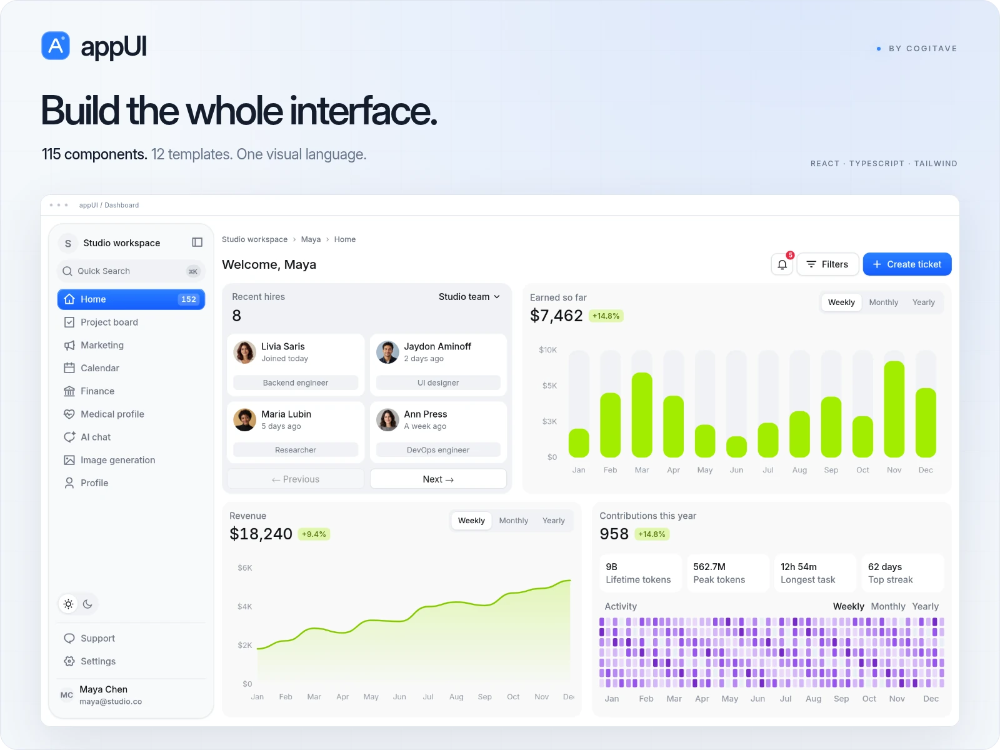
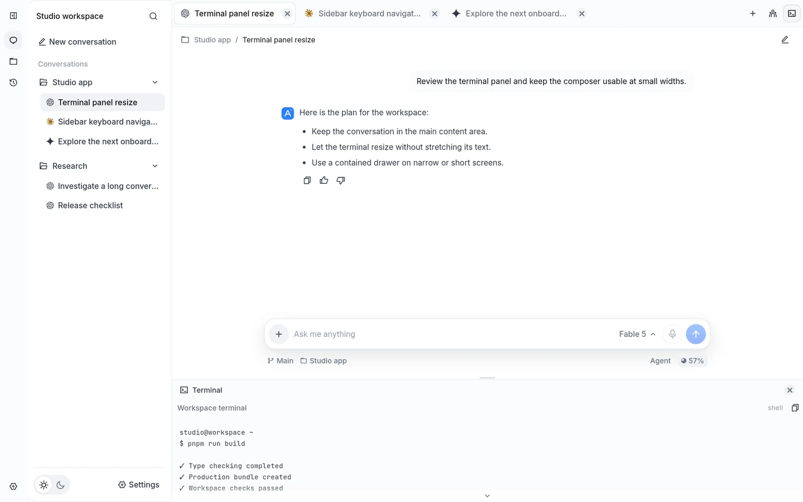
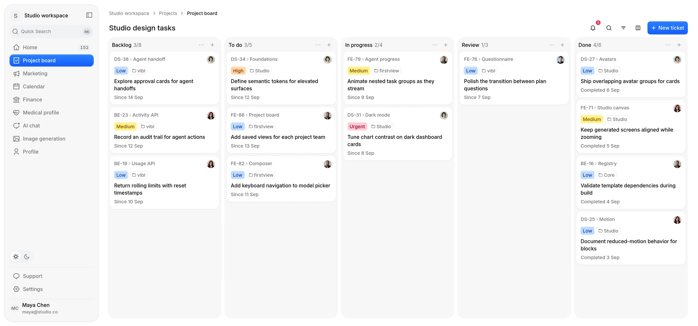

<div align="center">

# appUI

**A React design system for the whole product.**

Components, charts, and complete workspaces with shared color, typography, and motion.
Built by [Cogitave](https://github.com/cogitave).

[Live demo](https://cogitave.github.io/appUI/) · [Quick start](#quick-start) · [Components](#components) · [Templates](#templates) · [Source installer](#source-installer) · [Documentation](#documentation)

</div>

<picture>
  <source media="(prefers-color-scheme: dark)" srcset="docs/images/hero-dark.webp">
  <source media="(prefers-color-scheme: light)" srcset="docs/images/hero-light.webp">
  
</picture>

## One system, from controls to workspaces

Start with a button, compose a form, or open a complete dashboard. appUI uses the same foundations across every layer, so the pieces work together as your product grows.

- **Editable source.** Install components and their dependencies into your own project, with configurable paths and import aliases.
- **Shared foundations.** Light and dark appearances, ten accent palettes, semantic colors, and complete typography roles.
- **Interaction details.** Keyboard navigation, focus management, loading states, reversible transitions, and reduced-motion support.
- **Composed interfaces.** Conversations, team management, settings, data tables, charts, and application layouts built from the same controls.
- **Developer tooling.** A source installer, a read-only MCP server, and an installable agent skill.

Built with **React 19**, **TypeScript**, **React Aria**, **Tailwind CSS 4**, and **Motion**. The documentation application runs on **Next.js 16**.

## Quick start

Explore the **[hosted demo](https://cogitave.github.io/appUI/)** or run appUI locally.

Use **Node.js 22 or later**, npm, and Git.

```sh
git clone https://github.com/cogitave/appUI.git
cd appUI
npm ci
npm run dev
```

Open **[localhost:3000](http://localhost:3000)** to browse the documentation and interactive previews. No API keys or backend configuration are required.

| Explore locally | Route |
| --- | --- |
| Getting started | [/getting-started](http://localhost:3000/getting-started) |
| Component catalog | [/components](http://localhost:3000/components) |
| AI chat | [/templates/ai-chat](http://localhost:3000/templates/ai-chat) |
| Agent workspace | [/templates/agent-workspace](http://localhost:3000/templates/agent-workspace) |
| Dashboard | [/templates/home-dashboard](http://localhost:3000/templates/home-dashboard) |
| Project board | [/templates/project-board](http://localhost:3000/templates/project-board) |

## Components

The catalog includes **115 components, blocks, and charts**, plus **12 complete templates**.

| Layer | Included | Examples |
| --- | ---: | --- |
| Base controls | 66 | Button, Field, Select, Dialog, Command Menu, Tree, Split Pane |
| Composed blocks | 30 | Composer, Conversation, Data Table, Settings Modal, Team Members |
| Charts | 19 | Revenue, activity, funnels, radial charts, and responsive chart cards |
| Templates | 12 | Chat, agent workspaces, dashboards, profiles, project boards, and pricing |

Families group related APIs. A `variant` selects a visual presentation, props configure behavior and data, and a `preset` selects a composed screen. See the [component family guide](docs/component-families.md).

## Templates

The same controls carry through to complete application screens.

<picture>
  <source media="(prefers-color-scheme: dark)" srcset="docs/images/workspace-dark.webp">
  <source media="(prefers-color-scheme: light)" srcset="docs/images/workspace-light.webp">
  
</picture>

**Agent Workspace** — project navigation, conversation tabs, command search, and a resizable terminal. Drafts and selected content stay mounted across responsive layout changes.

<details>
<summary><strong>View the project board</strong></summary>

<picture>
  <source media="(prefers-color-scheme: dark)" srcset="docs/images/board-dark.webp">
  <source media="(prefers-color-scheme: light)" srcset="docs/images/board-light.webp">
  
</picture>

**Project Board** — drag-and-drop tickets, search, filters, ticket creation, and detail views.

</details>

| Family | Screens |
| --- | --- |
| Workspace | AI Chat, Agent Workspace, Multi-agent Chat, Chat Starter, AI Image Generation |
| Dashboard | Home, Finance, Marketing |
| Profile | Account, Medical |
| Standalone | Project Board, Paywall |

Templates expose typed props and callbacks through the [template exports](components/templates/templates.tsx). Previews use local sample data; connect your application services for persistence, authentication, model execution, and payments.

## Source installer

The CLI is distributed as a **local package**. Build it from this checkout:

```sh
npm run cli:pack
```

This creates `artifacts/distribution/appui-0.1.0.tgz`. In an existing **React 19 and Tailwind CSS 4** application, install that file using its actual absolute path:

```sh
npm install --save-dev /absolute/path/to/appui-0.1.0.tgz
npx --no-install appui init --install
npx --no-install appui add button select --install
```

Import `@/styles/appui/globals.css` once in the application entry point. Match the aliases in the generated `appui.json` with your TypeScript and bundler configuration.

Components are then available as editable source:

```tsx
"use client";

import { Button } from "@/components/appui/base/buttons/button";

export function SaveAction({ onSave }: { onSave: () => void }) {
  return <Button onPress={onSave}>Save changes</Button>;
}
```

The installer includes Base, Blocks, and Charts. Template source is included in this repository. Public npm publication, template license activation, and checkout services are not enabled in this release.

Use `appui diff` to review an update, `--dry-run` to preview installation, and `appui doctor` to check a destination project. Customized files are protected from automatic replacement. See the [CLI guide](packages/cli/README.md) for configuration and commands.

## MCP and agent skill

The local MCP server provides **eight read-only tools** to discover components, read source and examples, inspect themes, check a project, and plan installations.

From this checkout, install the CLI dependencies and start the stdio server for your target project:

```sh
npm ci --prefix packages/cli
node packages/cli/bin/appui.mjs mcp --cwd /path/to/your-app
```

To add the appUI skill to a project:

```sh
node packages/cli/bin/appui.mjs skill --cwd /path/to/your-app
```

The skill installs under `.agents/skills/appui`. Use `--client claude` or a custom `--path` for another project convention. Full setup is covered in the [CLI guide](packages/cli/README.md#local-mcp-and-agent-skill) and the local documentation at `/mcp` and `/skill`.

## Development

Install both sets of dependencies before running the checks:

```sh
npm ci
npm ci --prefix packages/cli
npm run typecheck
npm test --prefix packages/cli
npm run build
```

Additional commands:

| Command | Purpose |
| --- | --- |
| `npm run dev` | Run the documentation application and live previews |
| `npm run start` | Serve a production build |
| `npm run build:pages` | Export the documentation and interactive demos to `out/` |
| `npm run registry:build` | Rebuild the local component registry |
| `npm run cli:pack` | Build and package the source installer |
| `npm run colors:generate` | Generate accent palette CSS from the color configuration |
| `npm run colors:check` | Check that generated accent palettes are current |

The [Pages workflow](.github/workflows/pages.yml) verifies the installer, exports the site, and deploys it after updates to `main`. It reads the hosting path from GitHub Pages. For a local subdirectory export, set `NEXT_PUBLIC_BASE_PATH` to the deployment prefix, such as `/appUI`, before running `npm run build:pages`.

## Documentation

- [Local setup and distribution](docs/local-release.md)
- [Component families and configuration](docs/component-families.md)
- [CLI, source installation, MCP, and agent skill](packages/cli/README.md)
- [Template access and availability](docs/template-access.md)
- [Artwork, fonts, and icons](docs/asset-provenance.md)

---

Made by [Cogitave](https://github.com/cogitave).
